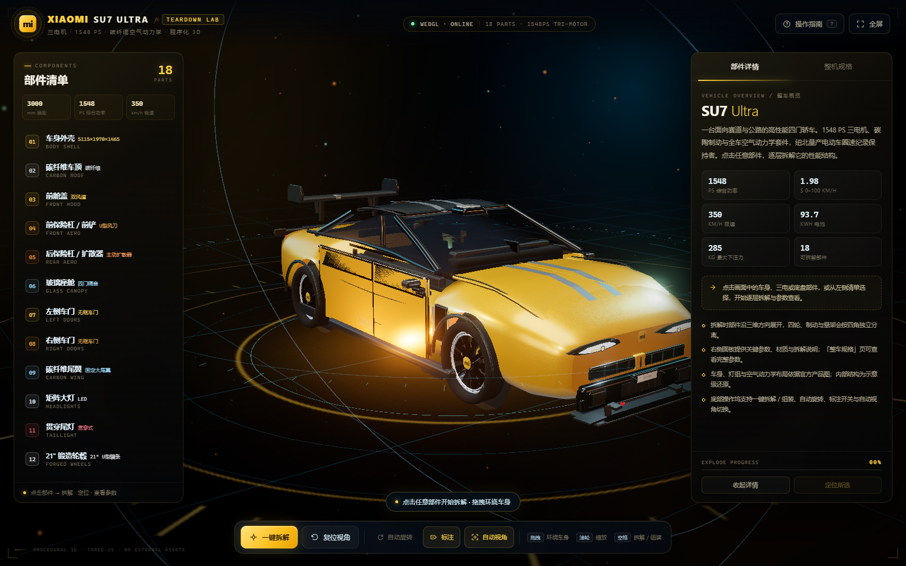
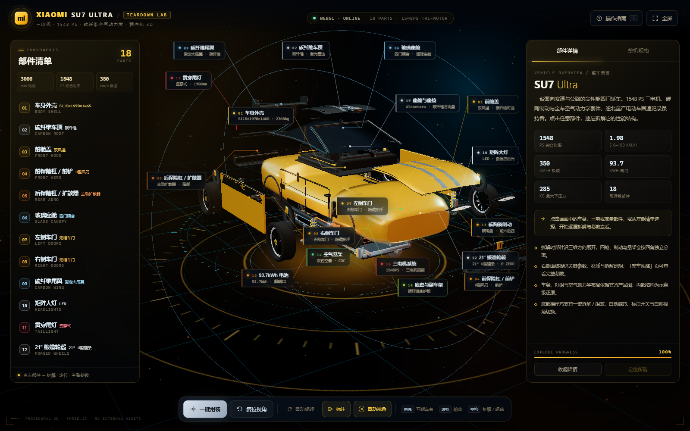

# Xiaomi SU7 Ultra · 3D 拆解实验室

一个完全由代码生成、可交互的 **小米 SU7 Ultra 三维拆解可视化**。使用 **Three.js + HTML + CSS + JavaScript**，不依赖任何外部 3D 模型、图片、字体或在线 CDN —— 车身、轮毂、灯组、三电、底盘与内饰均由程序在浏览器中实时建模，所有纹理（碳纤维、车漆、屏幕 UI、徽标、制动盘）均由 Canvas 绘制。





## 亮点

- **18 个可拆解部件**：车身、碳纤维车顶、前舱盖、前铲、后扩散器、玻璃座舱、四门、固定尾翼、灯组、轮毂、碳陶制动、空气悬架、电池、三电机、座舱与底盘。
- **点击即拆解**：点击任意部件，整车爆炸展开、镜头自动飞向该部件并高亮；四轮、制动与悬架按四角独立分离。
- **参数与结构对照**：右侧面板提供官方/媒体口径参数、材质与拆解说明；「整机规格」页汇总 1548 PS、1.98 s、350 km/h、93.7 kWh 等核心数据。
- **程序化建模**：车身由 20+ 组横截面放样生成，配合参数化轮毂、灯腔、尾翼、悬架、电池与三电机；轮拱由车漆材质的片元着色器按四个轮心实时裁切，形成可透视的真实开口。不依赖任何模型文件。
- **全程序化材质**：碳纤维斜纹、金属车漆闪粉、隔音玻璃反射、HyperOS 中控 UI、碳陶制动盘、24K 金色车标等均由代码绘制。
- **HUD 级视觉**：深色玻璃拟态 UI、青金色 HUD 圆环、Bloom 后处理、PMREM 环境反射、舞台网格与粒子。
- **桌面 / 移动端适配**：可折叠部件清单与详情抽屉、移动端视角与 FOV 调整、键盘快捷键。
- **可离线打开**：直接双击 `index.html` 即可运行，无需构建或服务器。

## 页面与交互

| 区域 | 内容 |
|---|---|
| 顶栏 | 车型标识、WebGL 状态、当前部件/部件总数 |
| 左侧 | 18 部件清单、尺寸/功率/极速概览 |
| 中央 | 3D 舞台、HUD 圆环、实时阴影与粒子 |
| 右侧 | 部件详情 / 整机规格；爆炸进度条 |
| 底部 | 一键拆解/组装、复位视角、自动旋转、标注、自动视角 |
| 标注 | 爆炸时显示部件编号、名称与关键参数，可单独关闭 |

**操作**

- 拖拽：环绕车身旋转
- 滚轮 / 双指：缩放
- 点击部件：选中并拆解，镜头自动定位
- `Space`：一键拆解 / 组装
- `R`：复位视角　`L`：标注开关　`F`：全屏　`Esc`：取消选中 / 关闭弹窗
- `?` / `H`：打开操作指南

## 可拆解部件

| # | 部件 | 关键信息 |
|---|---|---|
| 01 | 车身外壳 | 5115×1970×1465 mm · 轴距 3000 mm · 2360 kg |
| 02 | 碳纤维车顶 | 赛道专业套装选装 · 取消全景天幕 |
| 03 | 前舱盖 | 双风道 · 碳纤维选装 · 24K 金车标 |
| 04 | 前保险杠 / 前铲 | U 型风刀 · 格栅开口 +10% · 285 kg 下压力 |
| 05 | 后保险杠 / 扩散器 | 主动扩散器 · 尾部风道 · XIAOMI 字标 |
| 06 | 玻璃座舱 | 四门隔音隔热玻璃 · 溜背轮廓 |
| 07 | 左侧车门 | 无框车门 · 隐藏式门把手 · 碳纤维后视镜 |
| 08 | 右侧车门 | 无框车门 · 隐藏式门把手 · 碳纤维后视镜 |
| 09 | 碳纤维尾翼 | 固定大尾翼 / 3 挡可调 · 285 kg 下压力 |
| 10 | 矩阵大灯 | LED 矩阵 · 自适应远光 · 日行灯带 |
| 11 | 贯穿尾灯 | 约 1700 mm 宽 LED 光带 |
| 12 | 21" 锻造轮毂 | 前 265/35 ZR21 · 后 305/30 ZR21 · P ZERO |
| 13 | 碳陶瓷制动 | 碳陶盘 · 前六后四活塞固定卡钳 |
| 14 | 空气悬架 | 闭式双腔空气弹簧 + CDC · 可选绞牙 |
| 15 | 93.7kWh 电池 | 麒麟 II · 峰值放电 1330 kW · CLTC 630 km |
| 16 | 三电机系统 | 1548 PS · 前 V6s + 后双 V8s · 1.98 s |
| 17 | 座舱与座椅 | Alcantara · 碳纤维方向盘 · HyperOS · 25 扬声器 |
| 18 | 底盘与副车架 | 前双叉臂 / 后多连杆 · 碳纤维底护板 |

## 核心规格

| 项目 | 数据 |
|---|---|
| 尺寸 / 轴距 | 5115 × 1970 × 1465 mm / 3000 mm |
| 整备质量 | 2360 kg |
| 动力 | 三电机四驱 · 1548 PS / 1138 kW |
| 0–100 km/h | 1.98 s（不含起步，需半热熔轮胎） |
| 最高车速 | 350 km/h |
| 电池 | 93.7 kWh 麒麟 II · 峰值放电 1330 kW |
| 制动 | 碳陶盘 · 前六后四活塞固定卡钳 |
| 轮毂 / 轮胎 | 21" U 型锻造 / 前 265/35 ZR21 · 后 305/30 ZR21 |
| 空气动力学 | 最高 285 kg 下压力 @ 350 km/h |
| 价格 | 52.99 万元起 |

## 技术实现

```text
su7-ultra-3d/
├── index.html                 页面骨架 / HUD / 弹窗 / 启动层
├── css/style.css              HUD 主题、玻璃面板、响应式布局与动画
├── js/
│   ├── vendor/
│   │   └── three-bundle.min.js  本地打包 Three.js r169 + addons（唯一第三方代码）
│   ├── lib/
│   │   ├── textures.js          全部程序化 Canvas 纹理
│   │   └── model.js             SU7 Ultra 程序化几何 / 18 部件 / 爆炸偏移
│   └── app.js                 渲染器、相机、灯光、后处理、交互与 UI
├── docs/su7-ultra-reference.md  官方参数与设计/建模参考
├── screenshots/               最终验收截图
├── qa/review/                 独立 QA 报告与证据
├── reference-tmp/             本地建模参考图（不提交）
├── README.md
└── LICENSE
```

### 程序化车身

- 车身由 **20+ 个横截面** 沿 X 轴放样：每个截面使用超椭圆参数化生成，控制宽度、底边、肩线与高度；车头/车尾截面更方、车身中段更圆，端部以双面封口收束。
- 轮拱、侧裙、前铲、尾翼、灯腔、轮毂辐条、悬架弹簧、电池包与三电壳体均由 Three.js 基本几何 + 自定义 BufferGeometry 组合。
- **真实轮拱开口**：车漆材质注入片元着色器，按四个轮心位置裁切车身侧壁，并在轮拱内侧放置暗色轮罩；车轮因此不是“贴在车身外面”的装饰。
- 四轮 / 四组制动 / 四组悬架使用 **子装配动画**：部件分组后仍可按四角独立爆炸、旋转与重新归位。
- 玻璃、碳纤维、车漆、制动盘、屏幕、徽标等均为运行时生成的 `CanvasTexture`，不加载任何图片文件。

### 渲染与性能

- Three.js `r169`，`EffectComposer` + `UnrealBloomPass` + `OutputPass`。
- PMREM 程序化环境反射、ACES 色调映射、实时软阴影、自适应像素比。
- 页面直接以 `file://` 打开可用；全部资源相对路径加载。

## 数据与免责声明

- 官方参数来自小米汽车官网/官方产品资料及公开媒体；**媒体口径**（如 897 V、5.2C、11 min、430 mm 前盘、0–200 5.86 s、约 0.2 Cd）已在参数面板或文档中单独标注。
- 车身、灯组、空气动力学布局依据官方产品图与公开资料进行**风格化程序建模**；内部结构（电机、电池、悬架、底盘）为**示意级还原**，用于展示部件关系，不等同于工程爆炸图。
- **模型精度边界**：这是程序化低多边形重建，不是小米官方 CAD、油泥扫描或授权 3D 模型。GitHub 上可检索到的 SU7 Ultra GLB/选配器资产均缺少可再分发许可证，未引入本项目。外观比例、曲面与灯组细节仍与实车存在差距；如需 1:1 还原，应使用授权模型/CAD 数据替换 `js/lib/model.js` 的几何层。
- 本页面为独立开源可视化项目，与小米公司无关联；Xiaomi、SU7 Ultra 等商标归其权利人所有。

## 本地运行

直接打开 `index.html` 即可（需要支持 WebGL 2 的现代浏览器）。

如需本地服务器：

```bash
python -m http.server 8000
# http://localhost:8000
```

## License

项目代码以 [MIT License](LICENSE) 开源。Three.js 及其 addons 的 MIT 许可见 [THIRD-PARTY-NOTICES.md](THIRD-PARTY-NOTICES.md)。
